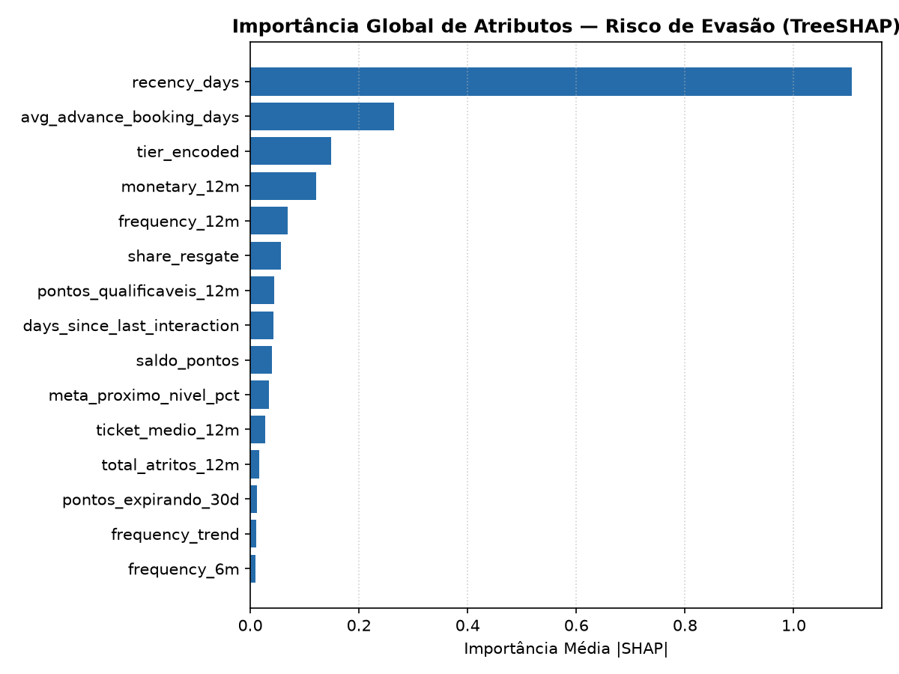
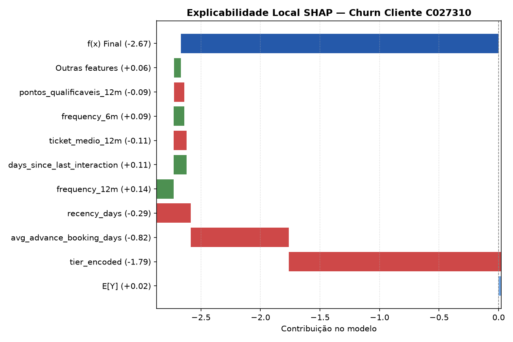
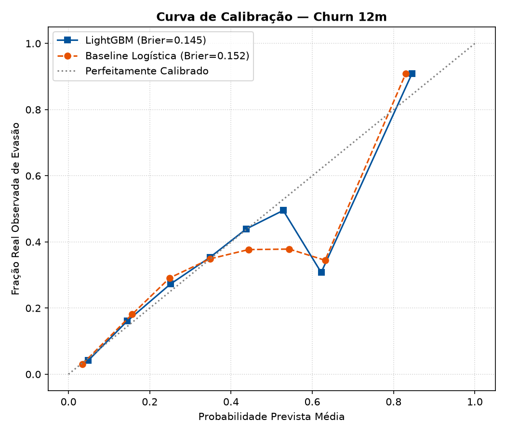

# Model Card — Risco de Evasão (Churn 12m)

## 1. Visão Geral e Uso Pretendido
- **Finalidade:** Estimação da probabilidade individual de evasão (churn) no horizonte de 12 meses.
- **Definição Operacional de Evasão:** Inatividade superior a **2× o intervalo típico entre voos do cliente**, com **mínimo absoluto de 180 dias sem compras** (configuração formal em `config/settings.yaml: modeling`).
- **Validação Temporal:** Origem móvel estrita (treino com corte em `2025-02-28`, teste com corte em `2025-08-31`). Zero vazamento temporal e zero split aleatório.
- **Uso no Sistema:** Cálculo do Valor em Risco (`CLV_12m × P(churn)`), classificação de estado de risco e disparo de intervenções preventivas do Agente.

## 2. Comparativo de Desempenho (Baseline vs Modelo Final)
Comparação entre o modelo linear baseline (**Regressão Logística**) e o estimador não-linear (**LightGBM Classifier**).

| Métrica | Baseline (Regressão Logística) | Modelo Final (LightGBM) | Ganho / Diferença | IC 95% Bootstrap | Significativo? |
|---|---|---|---|---|---|
| **ROC-AUC** | 0.8440 | 0.8566 | +0.0126 | [0.0107, 0.0143] | Sim |
| **PR-AUC** | 0.8307 | 0.8373 | +0.0066 | [0.0057, 0.0080] | Sim |
| **Brier Score** | 0.1516 | 0.1453 | -0.0063 | [-0.0070, -0.0055] | Sim |
| **Lift Top 10%** | 1.73x | 1.73x | +0.00x | — | — |

### Tabela de Calibração por Faixas (LightGBM)
| Bin | Clientes | Probabilidade Média Prevista | Fração Real de Evasão |
|---|---|---|---|
| 0 | 3682 | 0.0490 | 0.0421 |
| 1 | 5782 | 0.1448 | 0.1610 |
| 2 | 8361 | 0.2509 | 0.2727 |
| 3 | 7859 | 0.3482 | 0.3535 |
| 4 | 4309 | 0.4376 | 0.4393 |
| 5 | 529 | 0.5284 | 0.4953 |
| 6 | 13 | 0.6219 | 0.3077 |
| 8 | 19465 | 0.8451 | 0.9082 |

## 3. Explicabilidade (TreeSHAP)
Atributos de maior impacto sobre a probabilidade de evasão:

| Posto | Atributo | Média |SHAP| |
|---|---|---|
| 1 | `recency_days` | 1.1073 |
| 2 | `avg_advance_booking_days` | 0.2643 |
| 3 | `tier_encoded` | 0.1483 |
| 4 | `monetary_12m` | 0.1210 |
| 5 | `frequency_12m` | 0.0692 |
| 6 | `share_resgate` | 0.0565 |
| 7 | `pontos_qualificaveis_12m` | 0.0443 |
| 8 | `days_since_last_interaction` | 0.0429 |

### Figuras Auditáveis
- Importância Global: 
- Exemplo Local Waterfall: 
- Curva de Calibração: 

## 4. Governança e LGPD
- **Atributos Sensíveis Proibidos:** Variáveis demográficas (`faixa_etaria`, `genero`, `regiao`) são rigorosamente **bloqueadas** na matriz de treinamento. Testes automatizados de regressão garantem que qualquer vazamento quebre a execução (fail loud).
- **Corte Temporal:** Features calculadas exclusivamente com histórico anterior ao cutoff (`2025-08-31`).

## 5. Limitações Metodológicas
1. **Ambiente Sintético:** Modelo treinado e validado sobre a base sintética calibrada do projeto. As métricas atestam a integridade e calibração do pipeline analítico, não a taxa de retenção empírica na operação comercial.
2. **Definição de Churn:** A evasão em programas de fidelidade é não-contratual; clientes podem permanecer longos períodos sem voar antes de retornar sem que haja encerramento formal da conta.
