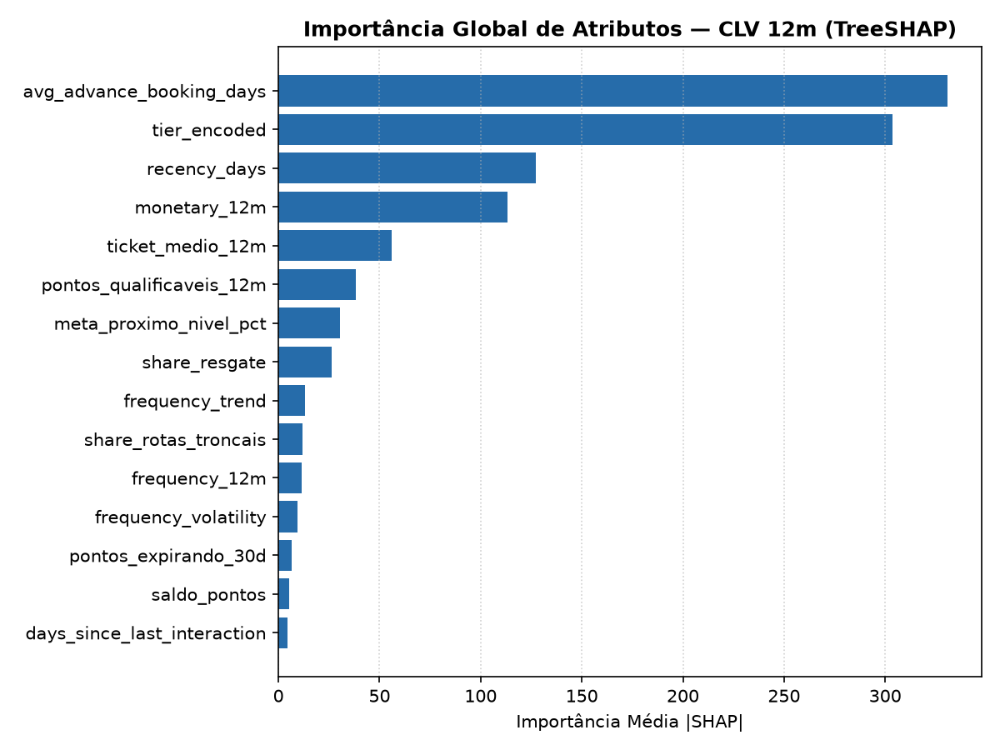
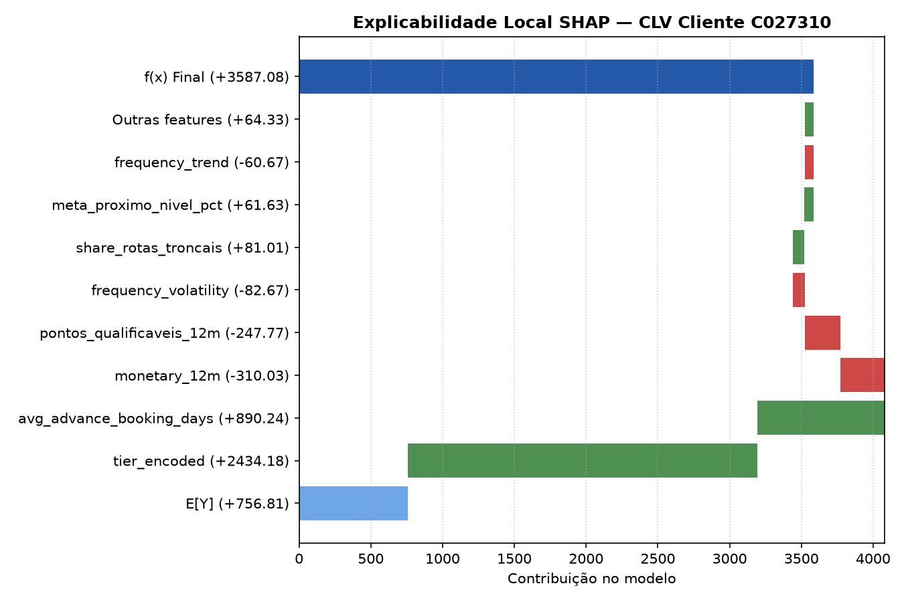
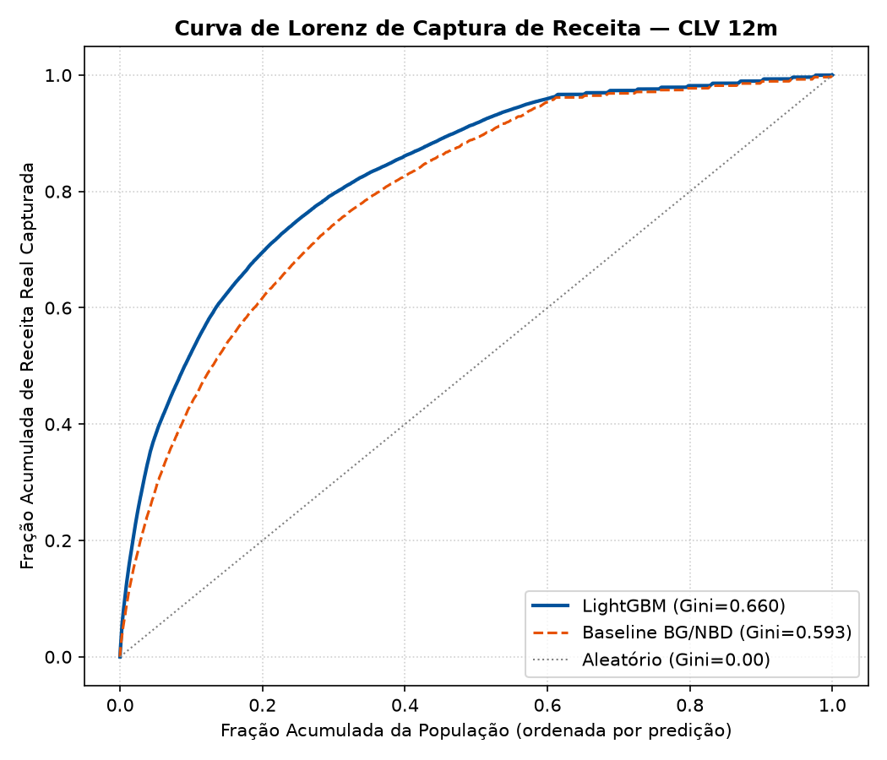

# Model Card — Customer Lifetime Value (CLV 12m)

## 1. Visão Geral e Uso Pretendido
- **Finalidade:** Previsão da receita total (BRL) que cada membro do Azul Fidelidade gerará nos próximos 12 meses.
- **Horizonte de Avaliação:** 12 meses futuros (`2025-09-01` a `2026-08-31`).
- **Validação Temporal:** Origem móvel estrita (treino com corte em `2025-02-28`, teste com corte em `2025-08-31`). Zero particionamento aleatório.
- **Uso no Sistema:** Componente de 60% do Score de Alto Valor (`ScoreAV`), cálculo do Valor em Risco (`CLV × P(churn)`) e priorização de ações do Agente.

## 2. Comparativo de Desempenho (Baseline vs Modelo Final)
A avaliação compara o modelo probabilístico não-contratual clássico (**BG/NBD + Gamma-Gamma**) contra o modelo de Gradient Boosting (**LightGBM**).

| Métrica | Baseline (BG/NBD + GG) | Modelo Final (LightGBM) | Ganho / Diferença | IC 95% Bootstrap | Significativo? |
|---|---|---|---|---|---|
| **WAPE** | 0.7974 | 0.6550 | -0.1424 | [-0.1495, -0.1354] | Sim |
| **MAE (BRL)** | R$ 606.12 | R$ 497.85 | R$ -108.27 | [-114.80, -101.77] | Sim |
| **Spearman** | 0.6106 | 0.7346 | +0.1240 | [0.1198, 0.1284] | Sim |
| **Gini de Captura** | 0.5935 | 0.6604 | +0.0669 | — | — |
| **Lift Decil 1** | 4.35x | 5.23x | +0.88x | — | — |

## 3. Explicabilidade (TreeSHAP)
Principais fatores que orientam a previsão de valor no LightGBM:

| Posto | Atributo | Média |SHAP| |
|---|---|---|
| 1 | `avg_advance_booking_days` | 330.9521 |
| 2 | `tier_encoded` | 303.5179 |
| 3 | `recency_days` | 127.1558 |
| 4 | `monetary_12m` | 113.3141 |
| 5 | `ticket_medio_12m` | 56.1848 |
| 6 | `pontos_qualificaveis_12m` | 38.1338 |
| 7 | `meta_proximo_nivel_pct` | 30.4386 |
| 8 | `share_resgate` | 26.4618 |

### Figuras Auditáveis
- Importância Global: 
- Exemplo Local Waterfall: 
- Curva de Lorenz / Concentração: 

## 4. Governança e LGPD
- **Atributos Sensíveis Proibidos:** Conforme a Política de IA Responsável do Projeto Aura 2.0 e a LGPD, variáveis como `faixa_etaria`, `genero` e `regiao` são **estritamente excluídas** de todas as etapas de treino e inferência.
- **Anti-Vazamento Temporal:** O pipeline aplica corte rígido (`<= 2025-08-31`). Nenhuma informação de voo ou gasto do período de avaliação entra no vetor de features.

## 5. Limitações Metodológicas
1. **Base Sintética Calibrada:** O modelo foi ajustado sobre base sintética calibrada em agregados ANAC e Azul RI. Os resultados comprovam a sanidade matemática e arquitetural do pipeline, mas não constituem comprovação empírica de acurácia no tráfego comercial real.
2. **Horizonte de 12 Meses:** O modelo é otimizado para o ciclo anual de fidelidade; previsões para horizontes plurianuais requerem recalibração com desconto de fluxo de caixa (DCF).
